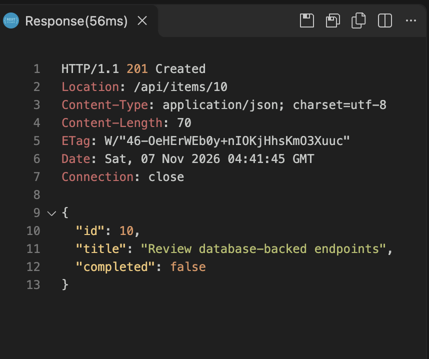
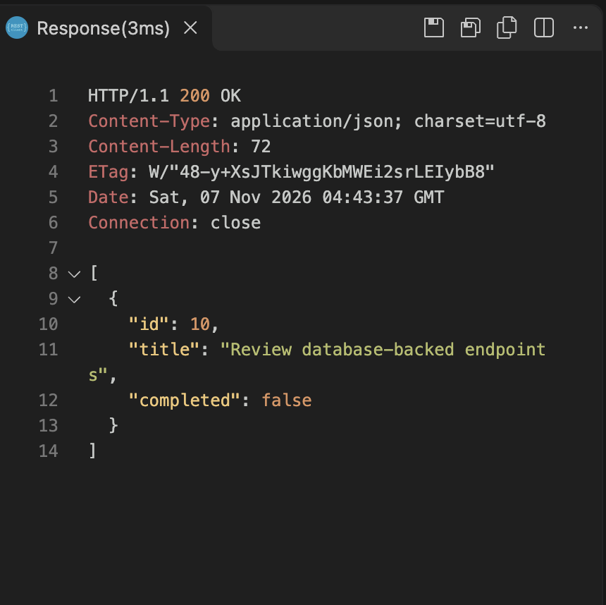
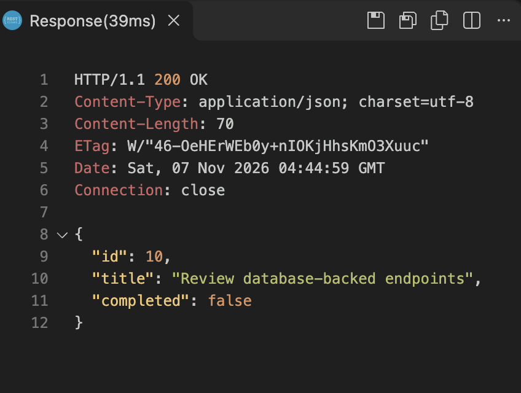
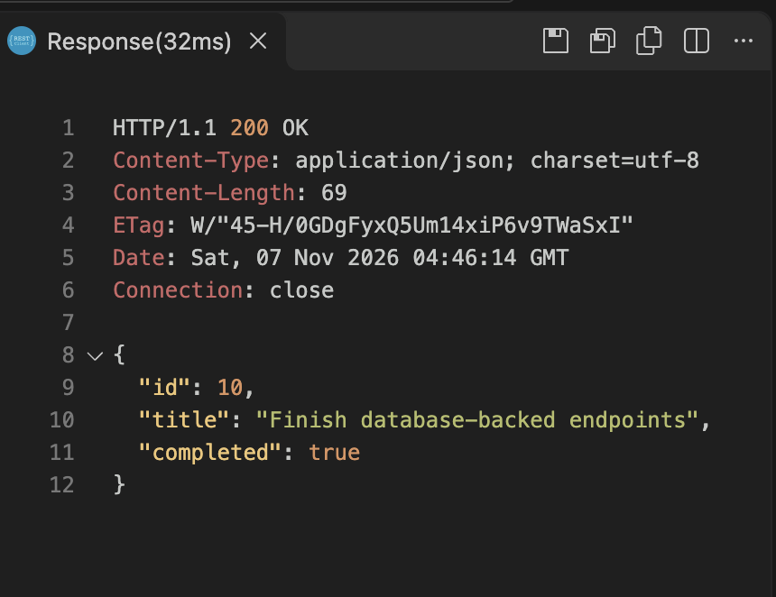
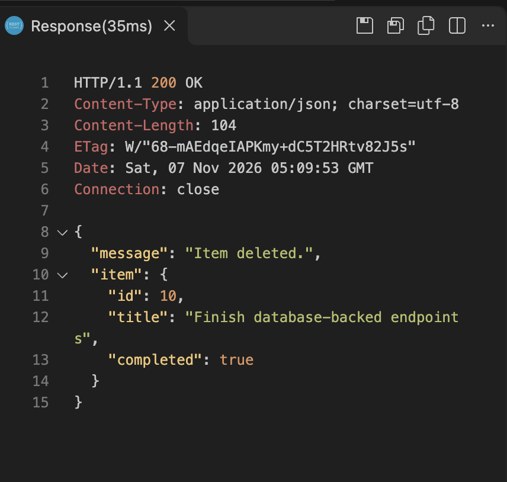
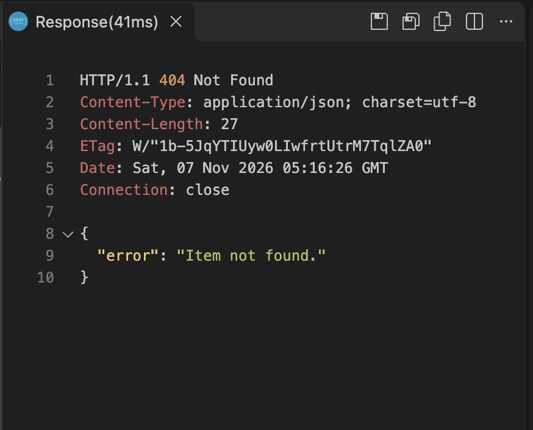
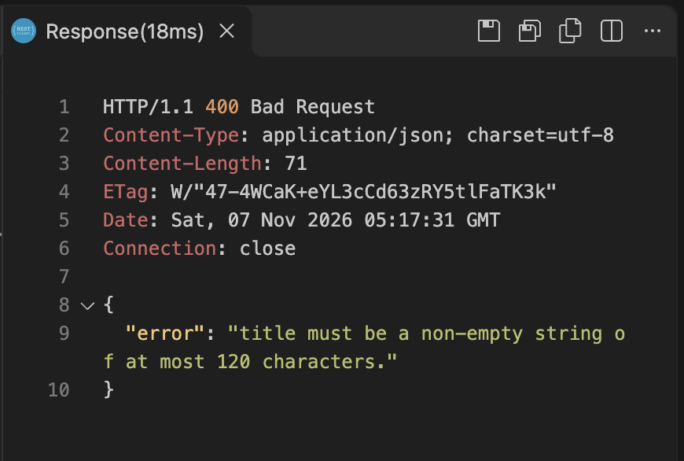

# Client response evidence

Status: All eight VS Code REST Client response captures have been received
and verified. A separate Terminal capture records the API restart used
for the persistence check.

| Request | Expected response | Client capture |
| --- | --- | --- |
| POST /api/items | 201 Created; generated ID and saved item | [Verified: 201, item ID 10](create-201.png) |
| GET /api/items | 200 OK; collection includes the item | [Verified: 200, array includes item 10](get-all-200.png) |
| GET /api/items/:id | 200 OK; matching saved item | [Verified: 200, single item 10](get-one-200.png) |
| PUT /api/items/:id | 200 OK; updated values and unchanged ID | [Verified: 200, item 10 updated](update-200.png) |
| GET /api/items/:id after an API restart | 200 OK; same updated item | [Verified: 200, updated item 10 survived restart](persistence-200.png) |
| DELETE /api/items/:id | 200 OK; deletion confirmation | [Verified: 200, item 10 deleted](delete-200.png) |
| GET /api/items/:id after deletion | 404 Not Found | [Verified: 404, item 10 not found](missing-404.png) |
| POST /api/items with a blank title | 400 Bad Request | [Verified: 400, blank title rejected](validation-400.png) |

## Create an item — verified

The supplied REST Client screenshot shows `HTTP/1.1 201 Created`,
`Location: /api/items/10`, and this response body:

```json
{
  "id": 10,
  "title": "Review database-backed endpoints",
  "completed": false
}
```



## Retrieve the collection — verified

The supplied REST Client screenshot shows `HTTP/1.1 200 OK` and a JSON array
containing item ID `10`, with title `Review database-backed endpoints` and
`completed: false`.



## Retrieve a single item — verified

The supplied REST Client screenshot shows `HTTP/1.1 200 OK` and one JSON
object with ID `10`, title `Review database-backed endpoints`, and
`completed: false`. The response is an object rather than a collection array.



## Update an item — verified

The supplied REST Client screenshot shows `HTTP/1.1 200 OK` and the updated
item. The ID remains `10`, the title is now `Finish database-backed endpoints`,
and `completed` is `true`.



## Persistence after restart — verified

After stopping and restarting the API, the supplied REST Client screenshot
shows `HTTP/1.1 200 OK` and the same item ID `10`, with title
`Finish database-backed endpoints` and `completed: true`. This confirms
that the updated item remained available across the API restart.

The separate [Terminal restart capture](restart-startup.png) records the
server starting again before this request.


## Delete an item — verified

The supplied REST Client screenshot shows `HTTP/1.1 200 OK`,
`"message": "Item deleted."`, and the removed item with ID `10`, title
`Finish database-backed endpoints`, and `completed: true`.



## Retrieve the deleted item — verified

After deleting item `10`, the supplied REST Client screenshot shows
`HTTP/1.1 404 Not Found` and this response body:

```json
{
  "error": "Item not found."
}
```



## Reject a blank title — verified

The supplied REST Client screenshot shows `HTTP/1.1 400 Bad Request` and
this validation response:

```json
{
  "error": "title must be a non-empty string of at most 120 characters."
}
```



The request definitions are in [requests.http](../requests.http).
The [local setup transcript](SETUP.md) and
[automated HTTP/SQL results](../TESTING.md) are separate supporting evidence.
