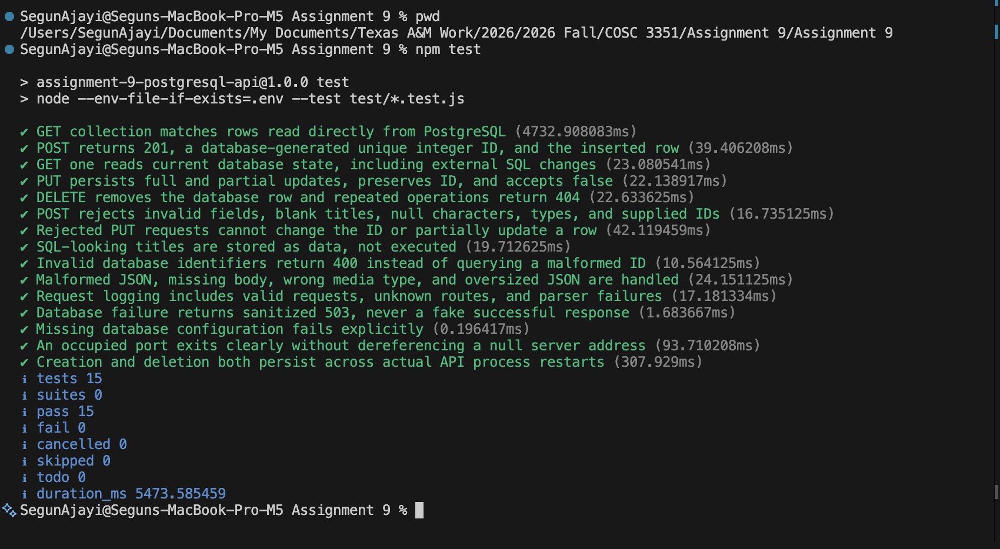
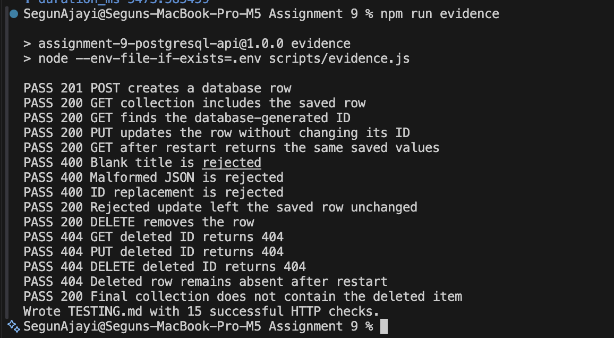

# Mac automated test results

The supplied Terminal screenshot records `npm test` running from the local
Assignment 9 project on November 7, 2026.

## Command

```sh
npm test
```

## Observed summary

| Result | Count |
| --- | --- |
| Tests | 15 |
| Passed | 15 |
| Failed | 0 |
| Cancelled | 0 |
| Skipped | 0 |
| Todo | 0 |

The passing suite covers database-backed routes, input validation, missing
items, SQL parameter handling, request logging, database failure responses,
occupied-port startup, and creation/deletion persistence across API restarts.



## Mac HTTP evidence generation

The separate supplied Terminal screenshot records:

```sh
npm run evidence
```

All 15 HTTP checks report `PASS`, and the final output confirms:

```text
Wrote TESTING.md with 15 successful HTTP checks.
```

The checks include successful database operations, rejected invalid input,
missing-item responses, and persistence/deletion across API restarts.



The separate [REST Client captures](CLIENT-RESULTS.md) document the manual
endpoint checks. The [main testing report](../TESTING.md) contains the
automated HTTP/SQL evidence.
