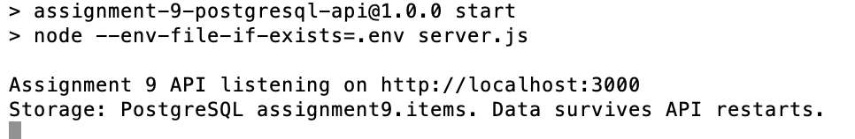

# Local setup verification

Environment: macOS with PostgreSQL 18.6 from Postgres.app.

The excerpts below are from the local Terminal output provided on November 7,
2026. Personal shell prompts and the local Documents path are omitted.

## 1. PostgreSQL database creation

Commands:

```sh
export PATH="/Applications/Postgres.app/Contents/Versions/latest/bin:$PATH"
createdb assignment9
```

The Terminal returned to the prompt without an error.

## 2. PostgreSQL command-line tools

Commands:

```sh
which psql
psql --version
```

Observed output:

```text
/Applications/Postgres.app/Contents/Versions/latest/bin/psql
psql (PostgreSQL) 18.6 (Postgres.app)
```

## 3. Dependency installation and local configuration

Commands, executed from the project folder:

```sh
npm ci
cp .env.example .env
```

Relevant installation output:

```text
added 79 packages, and audited 80 packages in 2s
found 0 vulnerabilities
```

The local `.env` contents are not included in this evidence.

## 4. Database table setup

Command:

```sh
npm run db:setup
```

Observed output:

```text
> assignment-9-postgresql-api@1.0.0 db:setup
> node --env-file-if-exists=.env db/setup.js

Database ready: assignment9.items. Existing items were preserved.
```

## 5. API startup

Command:

```sh
npm start
```

Observed output:

```text
> assignment-9-postgresql-api@1.0.0 start
> node --env-file-if-exists=.env server.js

Assignment 9 API listening on http://localhost:3000
Storage: PostgreSQL assignment9.items. Data survives API restarts.
[2026-11-07T04:23:19.923Z] GET /api/items
```

## 6. API restart

After stopping the previous API process, `npm start` was run again.
The supplied Terminal screenshot shows the API listening on port `3000`
and using PostgreSQL table `assignment9.items`.



## What this demonstrates

Installation, database table setup, and API startup succeeded on the Mac.
The GET log confirms that the request reached the API, but it does not show
the response body or HTTP status. Startup messages alone do not demonstrate
creation, update, deletion, or persistence across restarts. Those operations
require endpoint response evidence, recorded separately in
[client results](CLIENT-RESULTS.md) and the [automated report](../TESTING.md).
